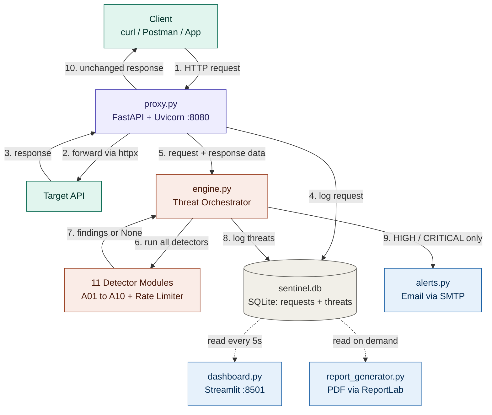
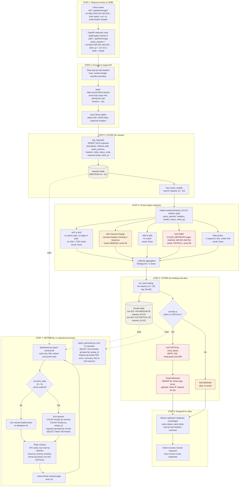

# 🛡️ SentinelAI — API Security Monitor

Runtime OWASP Top 10 threat detection proxy built with Python.
Zero cloud cost. Runs 100% locally.

## How SentinelAI Works
 
SentinelAI is a transparent reverse proxy that sits between a client and a target API. It forwards every request unchanged, and while doing so it inspects the request and the response for OWASP Top 10 attack patterns, stores everything in SQLite, alerts on serious findings, and shows the results on a live dashboard.
 
The target API needs no code changes. You only change the base URL your client calls, from the real API to `http://localhost:8080`.
 
There are two views below. **View 1** shows the components and how they connect. **View 2** follows one real request through the system and shows exactly what is stored and read at each step.
 
---
 
## View 1: System Structure

Solid arrows are the live request path. Dotted arrows are separate processes that only read the database file.


### Component Responsibilities

| Component | File | Responsibility |
|---|---|---|
| Proxy | `proxy.py` | Handles incoming requests and forwards them to the target API. |
| Threat Engine | `engine.py` | Runs detectors, collects findings, and triggers alerts. |
| Detectors | `detectors/a01_*.py` to `a10_*.py`, `rate_limiter.py` | Detects security vulnerabilities in API requests. |
| Database | `utils/database.py`, `sentinel.db` | Stores request logs and threat findings. |
| Alerts | `utils/alerts.py` | Sends email alerts for HIGH and CRITICAL threats. |
| Dashboard | `dashboard.py` | Displays security logs and threat statistics. |
| Reports | `reports/report_generator.py` | Generates PDF reports of detected threats. |

### Step-by-step description of View 1
 
1. **Client sends a request.** Any HTTP client sends its request to the proxy on port 8080 instead of the real API.
2. **Proxy forwards it.** The proxy removes hop-by-hop headers and forwards the request to the target API using an async `httpx` client.
3. **Target API responds.** The response (status, headers, body) comes back to the proxy.
4. **Request is logged.** The proxy writes one row to the `requests` table and receives that row's ID.
5. **Data goes to the engine.** The proxy passes the full request and response data, plus the request ID, to `engine.analyze()`.
6. **Detectors run.** The engine calls each of the 11 detector modules in turn.
7. **Findings come back.** Each detector returns `None` if it found nothing, or a list of findings. The engine merges them into one list.
8. **Findings are stored.** Each finding is written to the `threats` table, linked to the request by its ID.
9. **Alerts are sent.** Only findings with severity HIGH or CRITICAL trigger an email. Lower severities are stored silently.
10. **Response is returned.** The caller receives the target API's original response, unchanged.
**Reading side (dotted arrows).** The dashboard and the PDF report generator are separate from the proxy. They do not call it. They only read the same SQLite file the proxy writes.
 
---

## View 2: One Request Traced End to End
 
This view follows a single request. The example is an SSRF attempt that tries to reach the cloud metadata address, sent through the proxy to a vulnerable test app (OWASP Juice Shop):
 
```
GET /api/fetchImage?url=http://169.254.169.254/latest/meta-data/iam/security-credentials/
```
 
> The row IDs (101, 501, 502) and the exact findings in this walkthrough are illustrative. Your own run will show different IDs, and which findings fire depends on what the target returns.
 

 
**Color key:** grey cylinders are database writes, red nodes are the CRITICAL path, amber nodes are the MEDIUM finding that is stored but not emailed, and dotted arrows are read-only access by the dashboard and report generator.

### Step-by-step description of View 2
 
#### Step 1: Request arrives at the proxy
 
The client sends the request to `localhost:8080`. FastAPI has a single wildcard route, `/{path:path}`, that accepts every path and every HTTP method. The handler reads:
 
| Field | Value in this example |
|---|---|
| Method | `GET` |
| Path | `api/fetchImage` |
| Query string | `url=http://169.254.169.254/latest/meta-data/iam/security-credentials/` |
| Client IP | `127.0.0.1` |
| Body | empty |
| Authorization header | none |


#### Step 2: Forward to the Target API

1. **Remove hop-by-hop headers:** Removes headers like `Host`, `Content-Length`, and `Transfer-Encoding` to avoid forwarding connection-specific headers.
2. **Forward the request:** Uses `httpx.AsyncClient` with `await` and a 15-second timeout to send the request asynchronously.
3. **Receive the response:** The target API returns a status code, headers, and response body.
4. **Handle errors:**
   - `502 Bad Gateway` – Target API is unreachable.
   - `504 Gateway Timeout` – Target API takes too long to respond.

   In both cases, the request is logged and analyzed.

#### Step 3: Store the Request (First Database Write)

1. **Call `log_request()`:** Stores the request details in the `requests` table.
2. **Store request details:** Saves timestamp, method, path, query parameters, headers, request body, response status, response body, and client IP.
3. **Limit storage:** Truncates request and response bodies to avoid storing excessive data.
4. **Generate Request ID:** Uses `last_insert_rowid()` to retrieve the newly inserted row ID (e.g., `101`).
5. **Link findings:** This `request_id` connects the original request with all security findings generated during its analysis.

#### Step 4: The threat engine analyzes
 
`engine.analyze()` receives the request ID and all request and response data, then calls each detector. Every detector is independent and returns `None` or a list of findings.
 
| Detector | What it checked | Result |
|---|---|---|
| A01 Broken Access Control | Admin path, numeric ID in path, traversal | None |
| A02 Cryptographic Failures | Secrets or PII in request or response | None |
| A03 Injection | SQLi, XSS, command injection patterns | None |
| A04 Insecure Design | Missing security headers, error leaks, debug paths | **MEDIUM, score 50** |
| A05 to A09 | Misconfiguration, vulnerable components, auth, integrity, logging | None |
| A10 SSRF | Cloud metadata address, private IPs, dangerous schemes | **CRITICAL, score 95** |
| Rate limiter | Requests per IP in the sliding window | None |
 
The `_collect()` helper merges all results into one list. Here there are two findings from one request.


### Step 5: Store Findings and Send Alerts (Second Database Write)

1. **Store findings:** The engine assigns `request_id = 101` to each finding and calls `log_threat()`.
2. **Save to database:** Each finding is stored as a separate row in the `threats` table, linked to request 101.
3. **Check severity:** `send_alert()` checks the severity of each finding.
   - **MEDIUM (A04):** No email is sent because it is below the alert threshold.
   - **CRITICAL (A10):** An email alert is sent using SMTP SSL with threat details such as OWASP ID, severity, risk score, matched payload, client IP, timestamp, and request ID.

### Step 6: Respond to the Caller

1. **Return response:** The proxy sends the target API's original response back to the client.
2. **Preserve response:** The status code and response body remain unchanged. Only hop-by-hop headers are removed.
3. **Transparent inspection:** The client receives the response normally without needing to know that security inspection happened in between.

### Step 7: Retrieve and Display Data (Separate Processes)

The dashboard and PDF report work independently of the proxy. They read the data directly from the database.

**Dashboard (`dashboard.py`, Port 8501):**

1. **Read database:** Opens `sentinel.db` in read-only mode. SQLite WAL mode allows the dashboard to read while the proxy writes data.
2. **Cache data:** Uses `st.cache_data(ttl=5)` to reuse cached data for 5 seconds and reduce database queries.
3. **Fetch statistics:** Retrieves threat counts by severity and OWASP category, request activity, and the latest 100 threats.
4. **Display results:** Plotly displays KPI cards, OWASP category charts, severity distribution, request timeline, and threat logs.
5. **Auto-refresh:** The dashboard reloads every 5 seconds to show newly detected threats.

**PDF Report (`reports/report_generator.py`):**

1. **Read data:** Fetches threat records from the database.
2. **Group findings:** Organizes threats by OWASP category.
3. **Generate report:** Creates a PDF containing a cover page, executive summary, and separate sections for each OWASP category.
4. **On-demand generation:** The report is generated only when requested.


## Known Limitations

The following limitations were identified while testing the current implementation. Each point also includes a possible improvement.

### 1. Detection Accuracy

- **No Input Normalization:** Detectors scan raw input, so encoded attacks may go undetected.  
  **Improvement:** Decode URL-encoded and HTML-encoded input before scanning.

- **No Request Correlation:** Each request is analyzed separately. Attacks spread across multiple requests may go undetected.  
  **Improvement:** Track related requests and user activity over time.

- **Basic Detection Logic:** Some checks use simple conditions. For example, IDOR is flagged based on numeric IDs in URLs and missing authentication headers, but actual unauthorized access is not verified.  
  **Improvement:** Validate user permissions and resource ownership.

- **False Positives:** Some normal requests may be incorrectly reported as attacks.
  - A04 reports missing security headers even when they are not required for an API.
  - A02 may detect sensitive data in the request but report it as a response finding.
  - A01 may flag normal redirects from admin pages as security bypasses.
  - Some A04 rules overlap or report attacks under the wrong OWASP category.

  **Improvement:** Refine detection rules and verify findings before reporting them.

- **Limited Attack Coverage:** Some attacks cannot be detected at the proxy level.
  - DOM-based XSS happens inside the browser.
  - Advanced SSRF attacks, such as DNS rebinding and blind SSRF, are difficult to detect using simple string checks.
  - Vulnerabilities in third-party dependencies cannot be identified through HTTP traffic alone.
  - Business logic flaws require deeper application-level testing.

### 2. Proxy Limitations

- **Redirect Handling:** The proxy automatically follows redirects, so the client does not receive the original redirect response. Redirect destinations are also not checked for private IP addresses.  
  **Improvement:** Validate redirect destinations and apply SSRF protection.

- **Binary Response Handling:** Responses are converted into text before being returned. This can corrupt images, files, and other binary data.  
  **Improvement:** Forward response data as raw bytes.

- **Repeated Headers:** Multiple headers with the same name, such as `Set-Cookie`, may be lost or merged.  
  **Improvement:** Preserve repeated response headers.

- **Large Request Bodies:** Entire request bodies are loaded into memory, which can cause high memory usage for large uploads.  
  **Improvement:** Implement request streaming.

- **Blocking Analysis:** Detection, database operations, and email alerts run before sending the response. Blocking operations like SQLite and SMTP can slow down the proxy.  
  **Improvement:** Move analysis and email alerts to background tasks or a job queue.

- **Direct API Access:** SentinelAI only monitors traffic passing through its proxy. Direct requests to the target API bypass inspection.  
  **Improvement:** Restrict direct API access and route all traffic through the proxy.

### 3. Security of SentinelAI

- **No Proxy Authentication or TLS:** The proxy does not have built-in authentication or HTTPS protection. If exposed on the network, unauthorized users may access it.  
  **Improvement:** Add authentication, enable TLS, and restrict network access.

- **Sensitive Data Storage:** Request headers, cookies, authorization tokens, and request bodies are stored in the database without proper protection.  
  **Improvement:** Remove sensitive information before storing it and restrict database access.

- **No Alert Limiting or Data Cleanup:** Repeated attacks can generate too many emails and increase database size. Old records are not automatically deleted.  
  **Improvement:** Add alert throttling and database retention policies.

- **Regex Performance:** Some detection patterns may become slow when processing large or specially crafted inputs.  
  **Improvement:** Test regex patterns for performance and protect against excessive processing time.

### 4. Scalability and Operations

- **In-Memory Rate Limiting:** Rate-limit counters are stored in memory and reset whenever the application restarts. They are also not shared between multiple proxy workers.  
  **Improvement:** Use Redis for shared rate-limit tracking.

- **SQLite Limitations:** SQLite supports limited concurrent writes and is better suited for single-machine deployments.  
  **Improvement:** Move to PostgreSQL for larger deployments and multiple instances.

- **Dashboard Performance:** The dashboard loads large amounts of database data and refreshes every 5 seconds. This can slow down as records increase.  
  **Improvement:** Use SQL aggregation, pagination, and limited queries.

- **Detection Only:** SentinelAI detects threats, stores findings, and sends alerts. It does not automatically block malicious requests.  
  **Improvement:** Add an optional prevention layer to block requests based on threat severity and detection rules.
  
## Quick Start

```bash
# 1. Clone / enter project
cd sentinelAI

# 2. Create virtual environment
python -m venv venv
source venv/bin/activate        # Windows: venv\Scripts\activate

# 3. Install dependencies
pip install -r requirements.txt

# 4. Configure your target API
cp .env.example .env
# Edit .env and set TARGET_API=https://your-api.com

# 5. Start the proxy (Terminal 1)
uvicorn proxy:app --host 0.0.0.0 --port 8080 --reload

# 6. Start the dashboard (Terminal 2)
streamlit run dashboard.py

# 7. Send traffic through the proxy
# Change your API client's base URL to http://localhost:8080
```

## Project Structure

```
sentinelAI/
├── proxy.py                          Main proxy server (FastAPI)
├── engine.py                         Threat orchestrator
├── dashboard.py                      Streamlit UI
├── requirements.txt
├── .env.example                      Config template
├── detectors/
│   ├── a01_broken_access_control.py  OWASP A01
│   ├── a02_cryptographic_failures.py OWASP A02
│   ├── a03_injection.py              OWASP A03 (SQLi, XSS, CMDi)
│   ├── a04_insecure_design.py        OWASP A04
│   ├── a05_security_misconfiguration.py OWASP A05
│   ├── a06_vulnerable_components.py  OWASP A06
│   ├── a07_auth_failures.py          OWASP A07
│   ├── a08_integrity_failures.py     OWASP A08
│   ├── a09_logging_failures.py       OWASP A09
│   ├── a10_ssrf.py                   OWASP A10
│   └── rate_limiter.py               Sliding window rate limiter
├── utils/
│   ├── database.py                   SQLite helper
│   └── alerts.py                     Email alerting (smtplib)
├── reports/
│   └── report_generator.py           PDF compliance report
└── tests/
    ├── test_detectors.py             pytest unit tests
    └── test_payloads.http            Manual REST test file
```
## Running Tests

```bash
pip install pytest
python -m pytest tests/test_detectors.py -v
```


